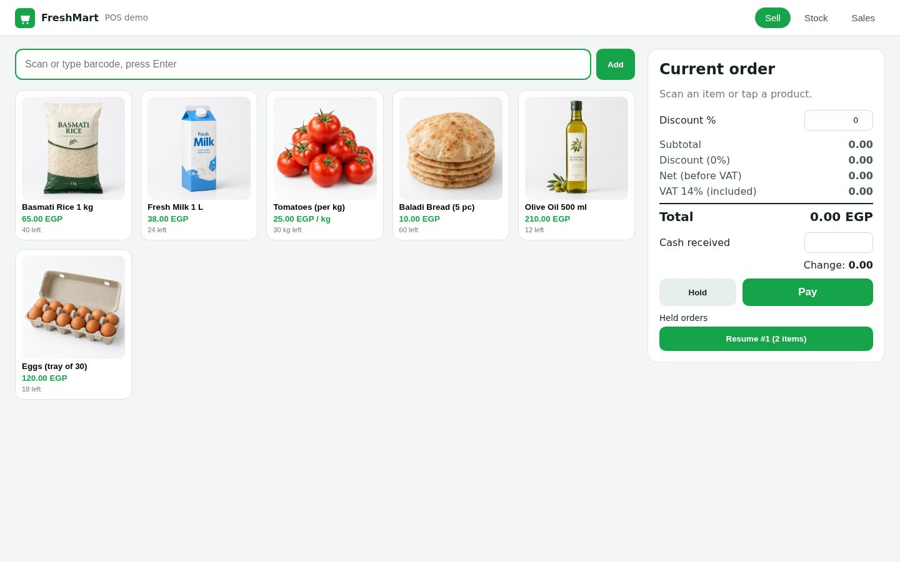
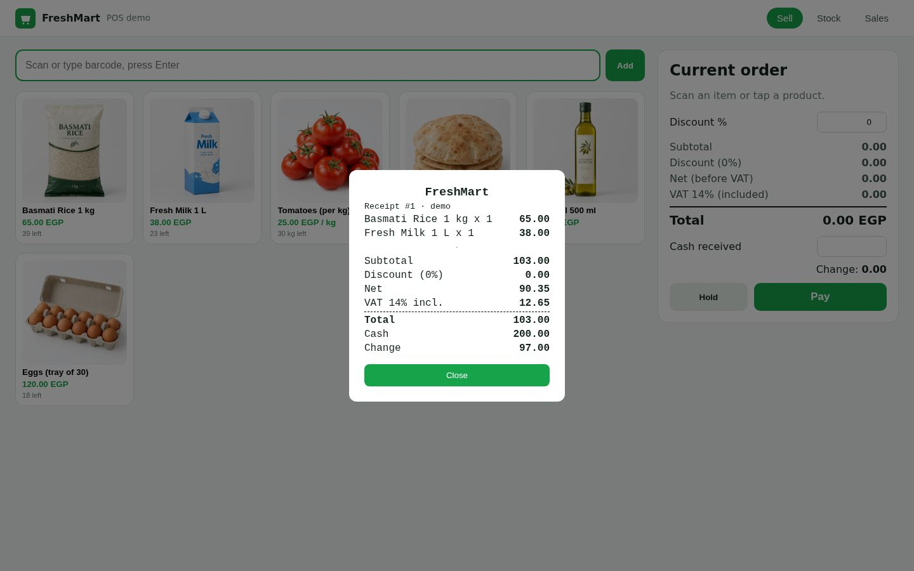
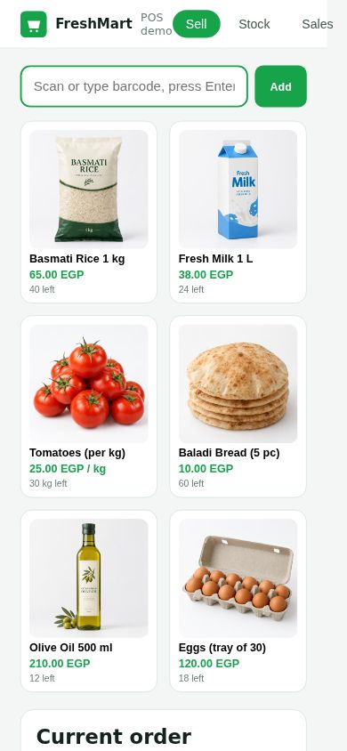

# FreshMart POS (React + Vite)

A grocery point-of-sale demo for a fictional supermarket. Brand and products are invented, product photos are AI-generated.

## Features
- Barcode entry (press Enter) and tap-to-add products
- Items sold by weight (tomatoes per kg, added in 0.5 kg steps)
- Discount in percent, clamped to 0-100
- Prices include 14% VAT; the receipt shows subtotal, discount, net, VAT, total, cash and change
- Money is kept in integer piastres, so there are no floating point errors
- Stock checks: cannot sell more than is in stock; low-stock marker
- Hold and resume orders, refund a sale (stock goes back)
- Stock and sales screens; data kept in the browser (localStorage)

## Run
```bash
npm install
npm run dev
npm run build
```
Try barcodes `6221001` to `6221006`.

## Preview




## Tests
24 checks in headless Chrome, including: unknown barcode, 33% discount rounding (103.00 gives 69.01 with 8.47 VAT), discount clamp to 100%, cash below total is blocked, change calculation, weight items, stock cap, hold and resume, reload persistence, refund restores stock, no horizontal overflow on mobile, no console errors.
